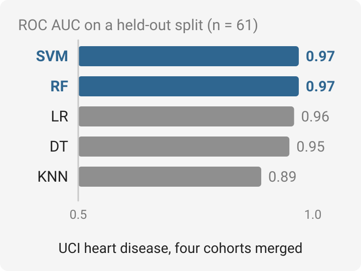

# Heart Disease Prediction

  <picture>
    <source media="(prefers-color-scheme: dark)" srcset="docs/overview-dark.svg">
    
  </picture>

Course 603 term project: predict the presence of heart disease from the four UCI heart-disease
cohorts (Cleveland, Hungary, Switzerland, VA Long Beach), merged into one table, one-hot encoded and
split 80:20 (`random_state=4`, 61 held-out patients).

## Results on the held-out split

| Model | ROC AUC | Accuracy |
|---|---|---|
| Support vector machine | **0.97** | 0.92 |
| Random forest | **0.97** | 0.92 |
| Logistic regression | 0.96 | 0.92 |
| Decision tree | 0.95 | 0.89 |
| k-nearest neighbours | 0.89 | 0.87 |

AUC is read from each model's ROC plot (`SVM.png`, `RF.png`, `LR.png`, `DT.png`, `KNN.png`);
accuracy is computed from the confusion matrices in the same figures. One small split, so treat
the ranking among the top three as a tie.

## Files

| File | Purpose |
|---|---|
| `download_data.py` | Download the four UCI files and merge them into one CSV |
| `Processing_data.ipynb` | Cleaning, type conversion, one-hot encoding → `processed_data.csv` |
| `Heart_Disease_Prediction.ipynb` | Model training and evaluation (figures above) |
| `Heart Disease Prediction.pdf` | Project report |

## Original notes

### download_data.py

1. Download four csv files from UCI database
    1. processed.cleveland.data
    2. processed.hungarian.data
    3. processed.switzerland.data
    4. processed.va.data

2. Merge the data into a single pandas dataframe + add column headers +  saves the data to a single csv file.

### Processing_data.ipynb
check dataset info
drop Na rows
converting columns from float to int, and then check datatypes

#### data preprocessing
One-Hot Encoding

Creating Dummy Variables for cp, thal and slope
Merge Dummy Variables to Main Data Frame 
drop unnecessary variables
save to new csv file (processed_data.csv)
