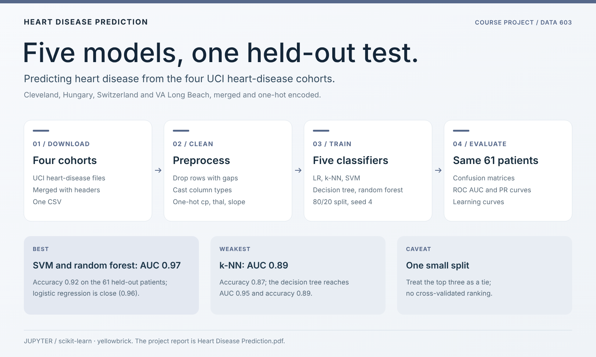
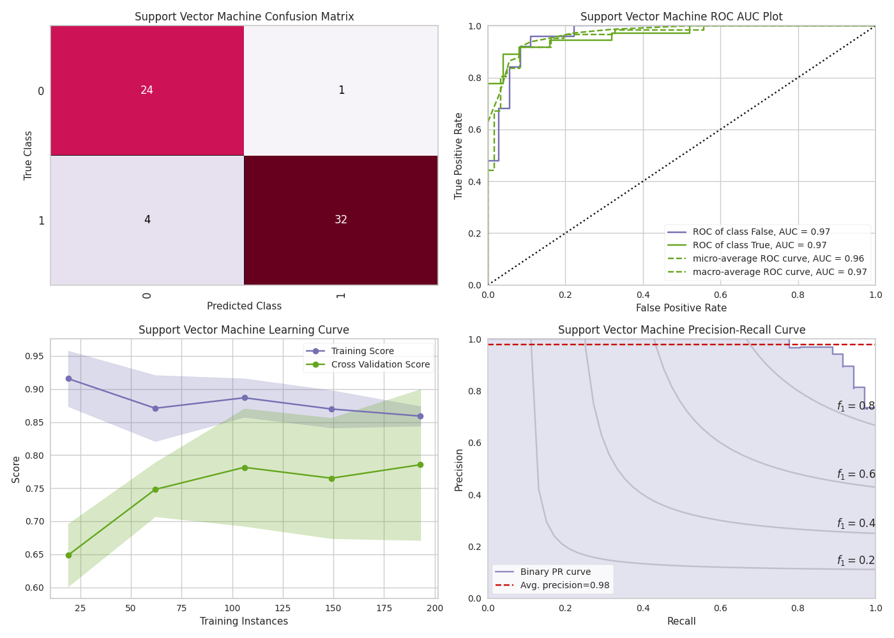
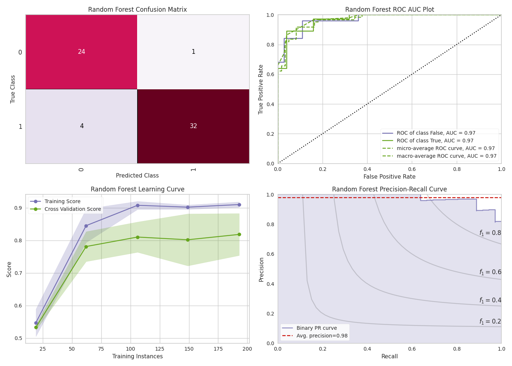

<div align="center">

# Heart Disease Prediction

**Five classifiers on the four UCI heart-disease cohorts, compared on one held-out test.**


[](https://www.ccao2679.com/coursework/#heart-disease-prediction)



</div>

<!-- problem-framing:start -->

## Problem and evidence

> **Do standard tabular classifiers outperform a simple baseline on held-out heart-disease records when preprocessing is fitted only on training data and dataset-source differences are respected?**

**Why it matters:** A course-project classifier is useful when its evaluation demonstrates reproducible learning rather than leakage from data preparation or source-specific patterns.

**Central tension:** Combining sources can increase sample size, but source differences and missing-value removal can change the population being evaluated. More complex classifiers need not transfer better.

[Full problem and verification plan](PROBLEM.md)

<!-- problem-framing:end -->

## Highlights

- **Data:** the four UCI heart-disease cohorts (Cleveland, Hungary, Switzerland, VA Long Beach), merged into one table and one-hot encoded.
- **Models:** logistic regression, k-nearest neighbours, SVM, decision tree and random forest on an 80/20 split (`random_state=4`, 61 held-out patients).
- **Result:** SVM and random forest reach ROC AUC 0.97; on a split this small, treat the top three as a tie.

## Results on the held-out split

| Model | ROC AUC | Accuracy |
|---|---|---|
| Support vector machine | **0.97** | 0.92 |
| Random forest | **0.97** | 0.92 |
| Logistic regression | 0.96 | 0.92 |
| Decision tree | 0.95 | 0.89 |
| k-nearest neighbours | 0.89 | 0.87 |

AUC is read from each model's ROC plot; accuracy is computed from the confusion matrix in the same figure.

<table>
<tr><td></td><td></td></tr>
<tr><td align="center"><sub>SVM</sub></td><td align="center"><sub>Random forest</sub></td></tr>
</table>

## Quick start

```bash
python download_data.py            # fetch and merge the four UCI files
jupyter notebook Processing_data.ipynb Heart_Disease_Prediction.ipynb
```

## Repository layout

| File | Purpose |
|---|---|
| `download_data.py` | Download the four UCI files and merge them into one CSV |
| `Processing_data.ipynb` | Cleaning, type conversion, one-hot encoding → `processed_data.csv` |
| `Heart_Disease_Prediction.ipynb` | Model training and evaluation |
| `SVM.png`, `RF.png`, `LR.png`, `DT.png`, `KNN.png` | Per-model evaluation figures |
| `docs/Heart Disease Prediction.pdf` | Project report |
| `processed.*.data`, `heart-disease.names` | UCI source files |

<details>
<summary>Original notes</summary>

### download_data.py

1. Download four csv files from UCI database
    1. processed.cleveland.data
    2. processed.hungarian.data
    3. processed.switzerland.data
    4. processed.va.data

2. Merge the data into a single pandas dataframe + add column headers +  saves the data to a single csv file.

### Processing_data.ipynb
check dataset info
drop Na rows
converting columns from float to int, and then check datatypes

#### data preprocessing
One-Hot Encoding

Creating Dummy Variables for cp, thal and slope
Merge Dummy Variables to Main Data Frame 
drop unnecessary variables
save to new csv file (processed_data.csv)

</details>
