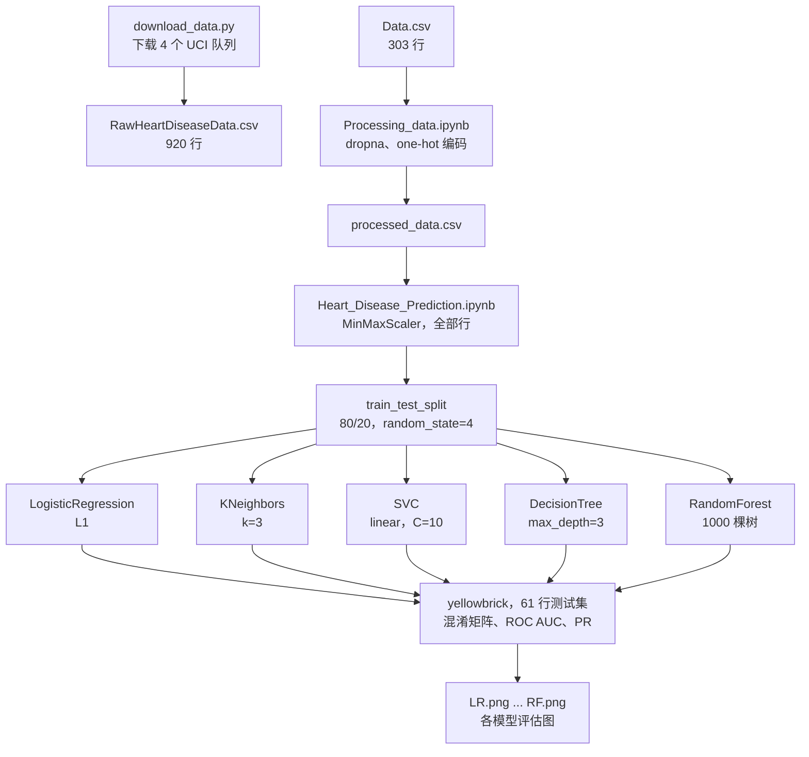

<div align="center">

# Heart Disease Prediction

[English](README.md) · **简体中文**

**在 UCI Cleveland 心脏病数据上训练五种分类器，并在同一个留出测试集上比较。**


[](https://www.ccao2679.com/projects/#heart-disease-prediction)


</div>

<!-- problem-framing:start -->

## 问题与依据

> **当预处理只在训练数据上拟合、并且考虑了数据来源差异时，常见的表格分类器在留出的心脏病记录上能否胜过简单基线？**

**为什么值得解决：** 课程项目中的分类器要有价值，其评估必须表明模型学到的是可复现的规律，而不是数据准备环节的泄漏或某个来源特有的模式。

**核心矛盾：** 合并多个来源可以扩大样本量，但来源差异和删除缺失值都可能改变被评估的人群。更复杂的分类器未必迁移得更好。

[完整问题与验证方案](PROBLEM.zh.md) · [English](PROBLEM.md)

<!-- problem-framing:end -->

## 亮点

- **数据：** `Data.csv`，即 303 名患者的 UCI Cleveland 队列经过重新编码的版本，对 `cp`、`thal`、`slope` 做 one-hot 编码。`download_data.py` 还会下载 UCI 的全部四个队列（Cleveland、Hungary、Switzerland、VA Long Beach）并合并为 `RawHeartDiseaseData.csv`（920 行），但两个 notebook 都不读取这个文件。
- **模型：** 逻辑回归、k 近邻、SVM、决策树和随机森林，使用 80/20 划分（`random_state=4`，留出 61 名患者）。
- **结果：** SVM 和随机森林的 ROC AUC 达到 0.97；测试集这么小，前三名应视为打平。

## 架构



箭头表示每一步读写的文件；五个模型共用同一次划分，并在同样的 61 行留出数据上评分。

## 留出集上的结果

| 模型 | ROC AUC | Accuracy |
|---|---|---|
| 支持向量机 | **0.97** | 0.92 |
| 随机森林 | **0.97** | 0.92 |
| 逻辑回归 | 0.96 | 0.92 |
| 决策树 | 0.95 | 0.89 |
| k 近邻 | 0.89 | 0.87 |

AUC 读自各模型的 ROC 曲线图；Accuracy 由同一张图中的混淆矩阵算出。notebook 在划分之前用全部 303 行拟合 `MinMaxScaler`，测试集的统计量因此泄漏进了缩放步骤。另外，`Data.csv` 中 `target = 1` 对应 UCI 编码里无心脏病（`num = 0`）的记录，所以 notebook 末尾的单病例示例输出的标签恰好相反。

<table>
<tr><td></td><td></td></tr>
<tr><td align="center"><sub>SVM</sub></td><td align="center"><sub>随机森林</sub></td></tr>
</table>

## 快速开始

```bash
jupyter notebook Processing_data.ipynb Heart_Disease_Prediction.ipynb   # reads Data.csv
python download_data.py   # optional: merges the four UCI files into RawHeartDiseaseData.csv
```

## 目录结构

| 文件 | 用途 |
|---|---|
| `Data.csv` | notebook 训练所用的重新编码版 Cleveland 数据（303 行） |
| `download_data.py` | 下载四个 UCI 文件并合并为 `RawHeartDiseaseData.csv`（notebook 不读取） |
| `Processing_data.ipynb` | 读取 `Data.csv`；类型转换、one-hot 编码 → `processed_data.csv` |
| `Heart_Disease_Prediction.ipynb` | 模型训练与评估 |
| `SVM.png`, `RF.png`, `LR.png`, `DT.png`, `KNN.png` | 各模型的评估图 |
| `docs/Heart Disease Prediction.pdf` | 项目报告 |
| `processed.*.data`, `heart-disease.names` | UCI 原始文件 |

<details>
<summary>原始笔记（英文）</summary>

### download_data.py

1. Download four csv files from UCI database
    1. processed.cleveland.data
    2. processed.hungarian.data
    3. processed.switzerland.data
    4. processed.va.data

2. Merge the data into a single pandas dataframe + add column headers +  saves the data to a single csv file.

### Processing_data.ipynb
check dataset info
drop Na rows
converting columns from float to int, and then check datatypes

#### data preprocessing
One-Hot Encoding

Creating Dummy Variables for cp, thal and slope
Merge Dummy Variables to Main Data Frame 
drop unnecessary variables
save to new csv file (processed_data.csv)

</details>
